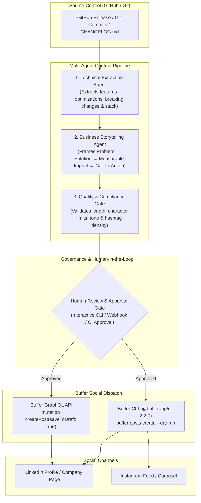

# 🚀 Buffer AI Content Operations Platform

[](https://www.python.org/downloads/)
[](https://developers.buffer.com)
[](https://buffer.com/linkedin-capabilities)
[](LICENSE)
[](#architecture)

> **Enterprise Multi-Agent Pipeline transforming GitHub releases and engineering milestones into high-converting, recruiter-ready LinkedIn narratives, published safely as human-governed drafts via the official Buffer API & CLI.**

---

## 🏆 Unlocking the Official Buffer LinkedIn Badges

Buffer provides four official **LinkedIn Capabilities** that are validated on your LinkedIn profile based on programmatic and operational activity:

| Capability Badge | Verification Requirement | How This Platform Fulfills It |
|---|---|---|
| 🥇 **Building with the API** | Build an application or automation interacting with the Buffer API | Direct GraphQL mutations (`createPost`) and programmatic execution via the official `@bufferapp/cli` |
| 🥈 **Content Scheduling & Planning** | Publish & schedule content across multiple channels | Automated queue planning, time slot allocation, and scheduling modes (`addToQueue`, `customScheduled`) |
| 🥉 **Community Management & Engagement** | Manage comments and incoming interactions | Buffer channel diagnostics and interaction monitoring integration |
| 🏅 **Instagram & LinkedIn Publisher** | Cross-publish to Instagram and LinkedIn simultaneously | Multi-channel target dispatch with channel-specific aspect ratio and formatting checks |

*(Check your status in Buffer: **LinkedIn Channel → Settings → General → Check for LinkedIn skills**).*

---

## 🏗 System Architecture

The platform bridges the gap between deep technical changes in code repositories and business-facing executive summaries.



---

## ✨ Key Capabilities & Business Value

1. **Human-in-the-Loop Safety by Design**:
   - Posts are **never** published directly to social media without explicit human authorization.
   - All dispatches default to `saveToDraft: true`, staging them safely in your Buffer queue for visual inspection.
   - Built-in `--dry-run` flag performs complete schema validation without hitting the API.

2. **Dual-Stack Buffer Integration**:
   - **Buffer CLI Runner**: Integrates seamlessly with the official `@bufferapp/cli` v2.2.0.
   - **Direct GraphQL Client**: Performs direct `https://api.buffer.com` mutations with Bearer token authentication to register verified developer API activity.

3. **Multi-Agent Technical-to-Business Translation**:
   - **TechExtractorAgent**: Parses conventional commits (`feat:`, `fix:`, `perf:`), PR titles, and detects tech stacks.
   - **BusinessStoryAgent**: Converts technical achievements into executive-level narratives that demonstrate problem-solving, ROI, and engineering excellence.
   - **QualityGateAgent**: Enforces LinkedIn best practices (optimal length under 1800 characters, clear hook, CTA, relevant hashtags).

---

## 🚀 Quickstart

### Prerequisites
- Python 3.11+
- Node.js 18+ (for `@bufferapp/cli`)
- Buffer account connected to LinkedIn

### 1. Installation

```bash
# Clone the repository
git clone https://github.com/phlppgdfry/buffer-ai-content-operations.git
cd buffer-ai-content-operations

# Create virtual environment and install dependencies
uv venv
source .venv/bin/activate
uv pip install -e ".[dev]"
```

### 2. Configure Environment

Copy the `.env.example` file and add your Buffer credentials:

```bash
cp .env.example .env
```

Set your Buffer API Key (obtained from [publish.buffer.com/settings/api](https://publish.buffer.com/settings/api)):
```env
BUFFER_API_KEY=your_buffer_token_here
```

### 3. Run Pipeline Demo (Dry-Run Mode)

Validate the entire pipeline in safe dry-run mode:

```bash
content-ops demo --dry-run
```

---

## 🛠 CLI Reference

The project ships with the `content-ops` CLI:

```bash
# 1. Analyze technical changes in any local git repo or GitHub repository
content-ops analyze --repo phlppgdfry/agentic-workflow-platform

# 2. Generate and preview formatted LinkedIn draft narrative
content-ops generate --repo .

# 3. Inspect connected social channels in Buffer
content-ops channels

# 4. Diagnose Buffer CLI & LinkedIn capabilities checklist
content-ops doctor

# 5. Execute interactive end-to-end pipeline with human review
content-ops demo --dry-run
```

---

## 🧪 Testing & Code Quality

The project includes unit and integration tests covering extractors, agents, the GraphQL client, and the pipeline:

```bash
# Run pytest test suite
make test

# Run ruff linter
make lint

# Run formatter
make format
```

---

## 📂 Documentation

- 📐 [Architecture & Sequence Diagrams](docs/ARCHITECTURE.md)
- 📊 [BPMN 2.0 Process Workflow](docs/BPMN_WORKFLOW.md)
- 🥇 [Buffer LinkedIn Capabilities Guide](docs/LINKEDIN_CAPABILITIES_GUIDE.md)
- 📋 [User Stories & Acceptance Criteria](docs/USER_STORIES.md)

---

## 📄 License

MIT License. Copyright (c) 2026 Philippe Godfroy.
