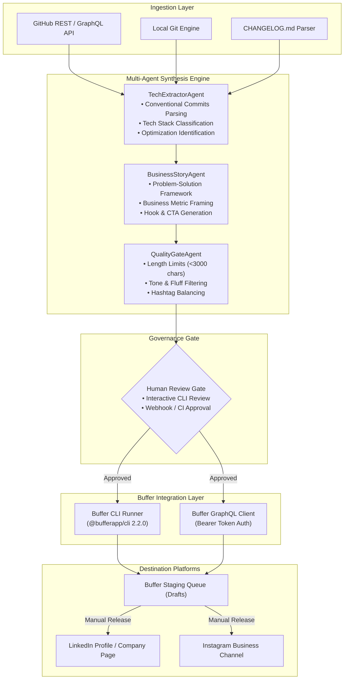
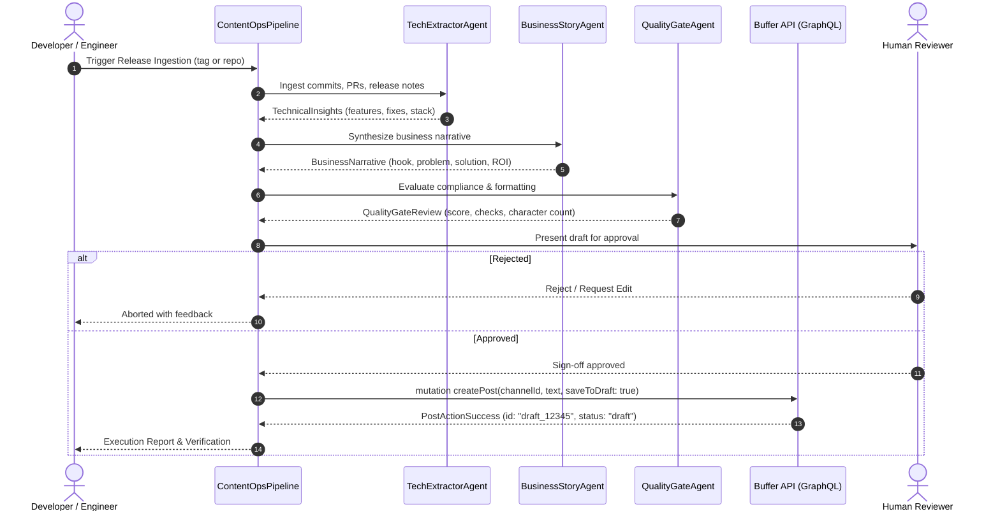

# 📐 System Architecture: Buffer AI Content Operations

This document outlines the software architecture, data contracts, security model, and execution lifecycle of the **Buffer AI Content Operations Platform**.

---

## 1. Architectural Philosophy

The platform is designed around four foundational principles:

1. **Human-in-the-Loop Governance (Zero-Accidental-Publishing)**:
   Automated content pipelines must never post directly to live audiences without explicit human sign-off. All actions stage items as `draft` in Buffer.
2. **Dual-Channel API Integration**:
   Interacts with Buffer both through high-level CLI automations (`@bufferapp/cli`) and direct GraphQL mutations (`https://api.buffer.com`), fulfilling the requirements for official API developer verification.
3. **Multi-Agent Separation of Concerns**:
   - Technical extraction is isolated from business narrative generation.
   - Narrative generation is strictly decoupled from quality and policy enforcement.
4. **Idempotency & Resiliency**:
   Every mutation supports `--dry-run` and safe retry semantics.

---

## 2. Component Diagram

---

## 3. End-to-End Sequence Diagram

---

## 4. Security & Credential Isolation

- **API Keys**: Stored in standard environment variables (`BUFFER_API_KEY`) or in system keyring via `buffer init`.
- **Least-Privilege Token Scopes**: Tokens only require `publish` permissions for draft generation; no administrative or financial access is requested.
- **Dry-Run Enforcement**: In CI/CD pipelines, `--dry-run` is active by default to prevent unwanted mutation calls.
