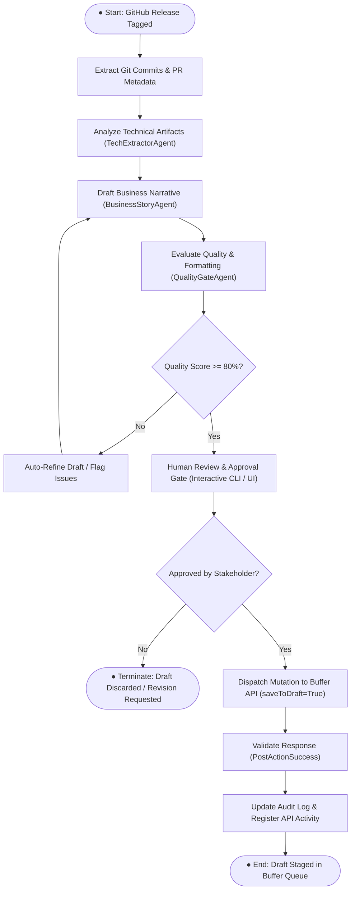

# 📊 BPMN 2.0 Process Workflow: Content Operations

This document defines the formal business process model for the **AI Content Operations Platform**, structured to provide Business Analysts, Product Managers, and Technical Architects with a clear operational understanding.

---

## 1. Process Overview & Business Objectives

| Parameter | Specification |
|---|---|
| **Process Name** | Automated Technical Milestone to Social Channel Operations |
| **Owner** | Developer Relations / Product Marketing / Engineering Lead |
| **Key Performance Indicator (KPI)** | Time-to-Draft &lt; 30 seconds; Zero accidental publishing defects |
| **Governance Standard** | ISO/IEC 42001 (Artificial Intelligence Management System) aligned human sign-off |

---

## 2. BPMN Process Diagram

---

## 3. Detailed Process Narrative

### Phase 1: Technical Ingestion
- **Trigger**: A new release tag (e.g. `v1.2.0`) is published on GitHub, or an engineer runs `content-ops publish`.
- **Action**: Ingestion engine parses conventional commits, changelogs, and pull request links.

### Phase 2: Multi-Agent Synthesis
- **Technical Extraction**: Isolates breaking changes, performance wins, and framework versions.
- **Narrative Framing**: Translates code into a three-part business story:
  1. *Challenge*: Why does this engineering work matter?
  2. *Solution*: What did we build?
  3. *Impact*: Measurable velocity, cost reduction, or architectural robustness.

### Phase 3: Governance & Review Gate
- Automated checks verify that character count is below LinkedIn's 3,000-character ceiling (target: ~1,500 chars).
- The human reviewer inspects the preview in the terminal or web dashboard.

### Phase 4: Safe Buffer Staging
- The post is created with `saveToDraft: true`.
- The draft appears inside the user's Buffer queue, where scheduling or manual broadcast can take place with 100% confidence.
